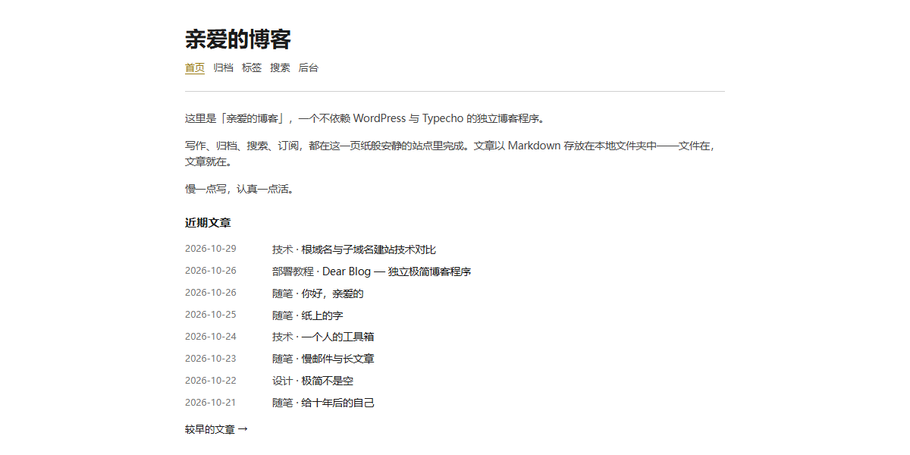
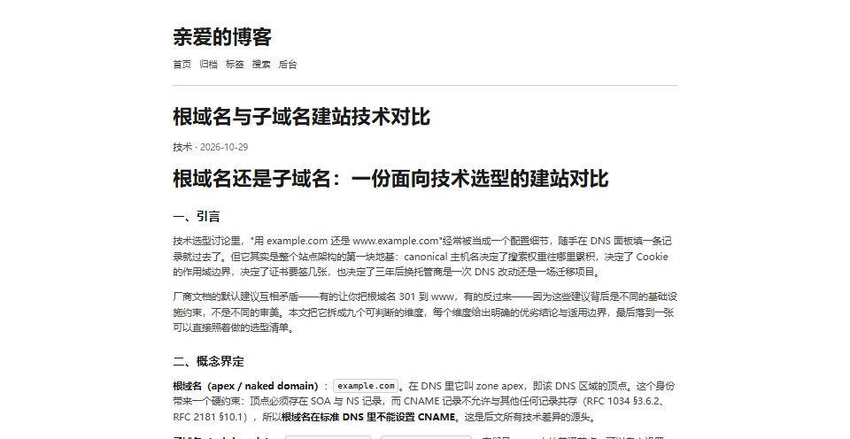

# Dear Blog

**一个不依赖任何框架和 npm 包的极简博客程序 —— 下载、`node server.js`、开始写。**

视觉复刻 [Bear Blog](https://bearblog.dev) 与 [Dear 主题](https://github.com/imjeff/typecho-dear) 的单栏纯文本排版：黑白灰为底，金色只用来标当前页，霞鹜文楷，亮/暗双主题。

- 示例站点：**<https://blog.liyinwaihe.com>** ← 本站就是用它跑的
- 代码托管：[GitCode](https://gitcode.com/liyinwaihe/dear) · [GitHub](https://github.com/liyinwaihe/dear-blog)
- 许可：[MIT](LICENSE)（视觉设计来源见[致谢](#致谢)）



## 为什么是它

| | Dear Blog | WordPress / Typecho |
|---|---|---|
| 安装 | 解压即用，**没有 `npm install`** | 需要 PHP + 数据库 + 安装向导 |
| 依赖 | **0 个**（只用 Node.js 内置模块） | 一堆插件与主题 |
| 数据 | 一个 Markdown 文件就是一篇文章 | 存在数据库里 |
| 体积 | 28 个文件，约 200 KB | 几十 MB 起 |
| 备份 | `cp -r content/ 你的U盘` | 导出数据库 + 上传目录 |
| 迁移 | 拷贝目录，改个配置 | 改域名要动数据库 |

适合：想长期写字、不想维护数据库、不希望十年后打不开自己博客的人。

## 截图

文章页：正文字号、行高、代码块与表格都按长文阅读调过，单栏、无侧边栏、无干扰元素。



后台写作界面与前台共用同一套设计令牌（黑白灰 + 金色当前项），需登录访问，这里不放图。

## 快速开始

```bash
cp config.example.json config.json   # 首次运行，改掉里面的 adminPassword
node server.js
```

- 前台：<http://localhost:3000>
- 后台：<http://localhost:3000/admin>

仅此而已。任何装了 Node.js（**≥ 16**）的机器直接跑，Windows / macOS / Linux 都行。

> 更安全的做法：启动前设环境变量 `ADMIN_PASSWORD=你的密码`（优先级高于 config.json），或登录后台在「站点设置」里改——密码会写回 config.json。

## 写作

在 `content/posts/` 新建一个 `.md` 文件：

```markdown
---
title: 我的第一篇
date: 2026-10-26
category: 随笔
tags: [开始]
---

正文用 Markdown 写。
```

保存，刷新页面，**即已发布**。加 `draft: true` 变草稿（前台与 RSS 都不显示）。首页那段「关于」改 `content/about.md`，站名/导航/每页篇数改 `config.json`。

不想登录后台也行——直接用编辑器写文件，服务器上的站点下次请求就更新了。

## 功能

**前台**

- 首页：关于外露 + 近期文章（日期 分类 · 标题，默认 8 篇）+ 分页
- 文章页：Markdown 渲染（标题/引用/代码块/表格/图片/列表/链接）
- 归档 `/archive`：按年月分组
- 搜索 `/search?q=`：标题、标签、分类、正文全文匹配
- 订阅 `/feed.xml`：RSS 2.0，链接跟随反代协议输出
- 标签：总览 `/tags`，单标签 `/tag/标签名`
- 暗色模式：跟随系统 + 页脚按钮切换 + localStorage 记忆，无闪白
- 移动端适配：375px 起可用，表格横向滚动不压列，输入框 ≥16px 不触发 iOS 缩放
- 错误页：404 / 405（前台只读，非 GET 一律 405）

**后台 `/admin`**

- 登录：密码 + HMAC 签名 Cookie 会话（HttpOnly / SameSite=Lax，7 天）
- 防爆破：10 分钟内错 5 次锁定，返回 429
- 写文章：标题/日期/分类/标签/草稿/Markdown 正文；中文标题自动用日期生成 slug；Origin CSRF 校验
- 管理：文章列表、编辑、删除
- 站点设置：站名、副标题、作者、每页篇数、页脚、导航（`名称 | 链接` 每行一项）、改密码
- 关于：编辑首页外露内容
- 预览：`POST /admin/preview` 返回渲染后的 HTML 片段

## 部署到服务器

程序无状态、零依赖，把目录传上去跑起来即可：

```bash
tar --exclude='server.log' --exclude='data/secret.key' -czf dear-blog-deploy.tar.gz .
scp dear-blog-deploy.tar.gz root@YOUR_SERVER:/opt/
ssh root@YOUR_SERVER "mkdir -p /opt/dear-blog && tar -xzf /opt/dear-blog-deploy.tar.gz -C /opt/dear-blog"
ssh root@YOUR_SERVER "cd /opt/dear-blog && chmod +x deploy.sh && ADMIN_PASSWORD=你的密码 ./deploy.sh 3000"
```

`deploy.sh` 会做 Node 版本检查、语法自检、启动和健康检查。

生产环境建议用 systemd 守护：

```ini
[Unit]
Description=Dear Blog
After=network.target

[Service]
WorkingDirectory=/opt/dear-blog
ExecStart=/usr/bin/node /opt/dear-blog/server.js
Environment=PORT=3000
Environment=ADMIN_PASSWORD=改成强密码
Restart=always
RestartSec=3

[Install]
WantedBy=multi-user.target
```

```bash
systemctl enable --now dear-blog
```

外网访问加一层 Nginx 反代（80/443 → 127.0.0.1:3000）并配 HTTPS，别忘了防火墙放行端口。反代记得传这两个头，否则后台 CSRF 校验和 RSS 链接会出错：

```nginx
proxy_set_header Host $host;
proxy_set_header X-Forwarded-Proto $scheme;
```

## 部署到 Vercel（可选）

仓库已含适配层（`api/index.js` + `vercel.json`）。导入仓库后 Framework Preset 选 **Other**，并在环境变量里加 `ADMIN_PASSWORD` 与 `SESSION_SECRET`（长随机串）。

| 能力 | Vercel | 自建服务器 |
|---|---|---|
| 前台阅读 / 搜索 / RSS | 完全可用 | 完全可用 |
| 写文章到本地文件 | **不可用**（文件系统只读） | 可用 |
| 后台登录 | 可用（需 `SESSION_SECRET`） | 可用 |
| 后台发文 / 删文 / 改设置 | **不可用** | 可用 |

结论：**Vercel 适合「本地写 Markdown → git push → 自动发布」**；要在线后台写作就留在自己的服务器上。两边可以同时跑，同一个仓库。

## 目录结构

```
dear-blog/
├── server.js              入口（只装配）
├── config.json            站点配置（不入库，从 config.example.json 复制）
├── data/secret.key        首次启动自动生成的会话密钥（不入库）
├── content/
│   ├── about.md           首页关于
│   └── posts/*.md         文章（front-matter + Markdown）
├── lib/
│   ├── router.js          路由分发（前台 + 后台委派）
│   ├── site.js            配置 / 文章加载 / front-matter
│   ├── markdown.js        内置渲染器
│   ├── templates.js       前台页面模板
│   ├── admin.js           后台业务
│   ├── admin-templates.js 后台页面模板
│   ├── auth.js            HMAC 会话 + 登录限速
│   └── send.js            统一响应出口
├── public/style.css       唯一样式表（前台后台同一套令牌）
└── docs/*.png             README 截图
```

## 设计规范

样式表头部就是令牌区：`--bg / --text / --text-light / --faint / --border / --box-border / --box-bg`，亮暗各一套。金色只给当前导航项，红色只留给错误态。全站无 JS 框架、无外部字体请求、无统计脚本——霞鹜文楷未安装时自动回退系统字体。

## 更新日志

见 [CHANGELOG.md](CHANGELOG.md)。

## 许可

代码以 [MIT](LICENSE) 发布，可自由使用、修改、商用、二次分发。

视觉排版结构参考了 [Dear 主题](https://github.com/imjeff/typecho-dear)（CC BY-NC-SA 4.0）与 [Bear Blog](https://bearblog.dev)。若你要把这个样式用于商业项目，建议先确认上游授权——本仓库只做了风格重实现，未复制其代码资源。

## 致谢

- [Dear 主题](https://github.com/imjeff/typecho-dear) — 排版结构复刻来源
- [Bear Blog](https://bearblog.dev) — 极简博客的原始精神
- [霞鹜文楷 / LXGW WenKai](https://github.com/lxgw/LxgwWenKai) — 正文字体
